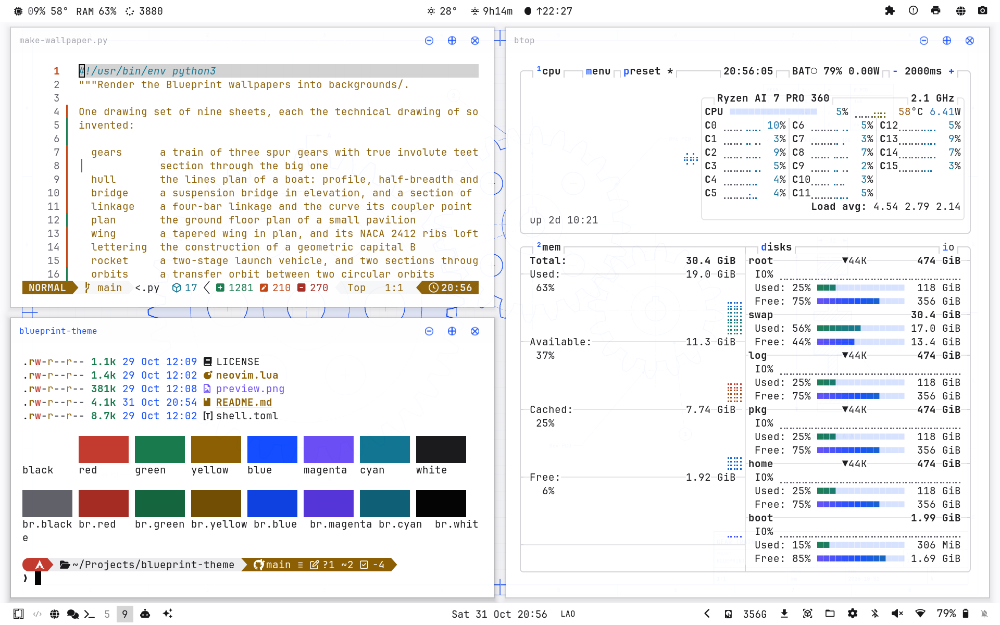

# Blueprint — an Omarchy theme

A light theme for coding in daylight, even out in the sun: white panels,
near-black text, and one blueprint blue, in the colors of
[blueprint.page](https://blueprint.page)'s design system.



## Install

```bash
omarchy theme install https://github.com/JarnKet/omarchy-blueprint-theme
```

Omarchy switches GTK apps, browsers and VS Code to their light mode with it,
and generates VS Code, Neovim, terminal and btop colors from the palette.

## Built for sunlight

Body text is 17.7:1 against the white background, and every terminal color
is at least 5.2:1, so nothing washes out in bright light. Disabled text,
which is meant to recede, is lighter.

| Role                | Hex       | From blueprint.page |
|---------------------|-----------|---------------------|
| background          | `#FFFFFF` | panel               |
| dark background     | `#F7F7F8` | page background     |
| darker background   | `#EEEFF1` | shell               |
| foreground          | `#18181B` | text                |
| light foreground    | `#3F3F46` | secondary text      |
| muted               | `#5F5F68` | muted text          |
| accent, blue        | `#104BFF` | brand blue          |
| magenta             | `#6A4CF5` | AI violet           |
| red                 | `#C2372B` | danger              |
| green               | `#16794A` | success text        |
| yellow              | `#8A5D00` | warning, darkened to read on white |
| cyan, orange, brown | `#0E7490`, `#C2410C`, `#7C4A1E` | added in the same weight |

## Files

- `colors.toml`: the palette (`mode = "light"`).
- `shell.toml`: bar, popups, menus and notifications on white with
  blueprint.page's neutral `#E4E4E7` lines; blue is kept for selection and
  focus.
- `btop.theme`: neutral boxes; only the graphs carry color.
- `neovim.lua`: the generated aether palette, marked as a light theme
  (`background = "light"`) so Neovim and its plugins pick light variants.
  Omarchy uses it from a linked checkout; an installed copy falls back to the
  generated one.
- `icons.theme`: `Yaru-blue`.
- `backgrounds/`: nine wallpapers drawn by `tools/make-wallpaper.py`
  (`make-wallpaper.py all`, or name the ones to redo). They are one drawing
  set: each is a sheet with the same frame and title block (SHEET n / 9), a
  technical drawing of something invented, in blue ink only. One feature per
  sheet gets a heavier line and a pale wash of the same blue.
  1. **gears**: three spur gears with true involute teeth, and a section
     through the big one
  2. **hull**: the lines plan of a boat (profile, half-breadth plan, body
     plan) with its table of offsets
  3. **bridge**: a suspension bridge in elevation, and a section of its deck
  4. **linkage**: Chebyshev's lambda, a four-bar linkage whose coupler point
     runs nearly straight for part of each turn
  5. **plan**: the ground floor plan of a small pavilion
  6. **wing**: a tapered wing in plan, and its NACA 2412 ribs lofted
  7. **lettering**: the construction of a geometric capital B
  8. **rocket**: a two-stage launch vehicle, and two sections through it
  9. **orbits**: a transfer orbit between two circular orbits

  Cycle them with `omarchy theme bg next`.
- `preview.png`: the theme switcher thumbnail, from `tools/make-preview.sh`
  (takes over an empty workspace for about 10 seconds).
  `tools/palette.sh` prints the terminal palette.

## Developing

Link a checkout instead of installing, so edits apply on the next
`omarchy theme set blueprint`:

```bash
ln -s ~/Projects/blueprint-theme ~/.config/omarchy/themes/blueprint
```

## How this was made

The idea and the choices are mine: a bright theme I can read outdoors,
blueprint.page's colors, and the drawing-set wallpapers. The files were
written by Claude (Anthropic's AI) in Claude Code from what I asked for. I
tried the theme on my own machine and take responsibility for what's here.

## Credits

The palette follows the design tokens of [blueprint.page](https://blueprint.page).
Not affiliated with Blueprint.

## License

MIT; see [LICENSE](LICENSE).
